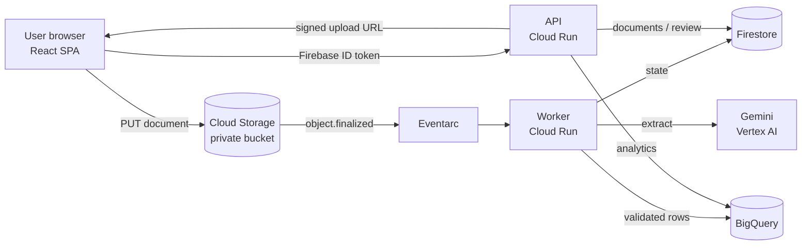

# AI-Powered Receipt & Invoice Extractor

Event-driven pipeline using **Gemini on Vertex AI**, **Cloud Run** and **BigQuery** to extract,
validate and load structured receipt and invoice data — with a human-in-the-loop review queue for
anything the validator does not trust.

> **Status:** under active development. Phases 1–15 (project setup, Gemini extraction, validation, secure uploads, automatic processing, BigQuery analytics, REST API, web app, review workflow, accuracy benchmark, Terraform infrastructure, CI/CD, security hardening, monitoring, end-to-end testing) are complete; see
> [IMPLEMENTATION_PLAN.md](IMPLEMENTATION_PLAN.md) for the phase-by-phase plan and progress.
> Features below are the target design; this README is completed in Phase 16.

## How it works



1. The browser asks the API for a short-lived signed URL and uploads the file straight to Cloud Storage.
2. The upload fires an Eventarc event; the worker extracts fields with Gemini (structured JSON output).
3. A rule-based validator checks required fields, arithmetic and duplicates.
4. Valid documents are merged into BigQuery; the rest go to a manual review queue.
5. Reviewers correct fields (with a full audit trail) and approve or reject.

## Tech stack

| Layer | Technology |
|-------|-----------|
| Frontend | React, TypeScript, Vite, Tailwind CSS, TanStack Query |
| Backend | Python 3.12, FastAPI, Pydantic, uv workspace |
| AI | Gemini via Vertex AI (Google Gen AI SDK) |
| Data | Cloud Storage, Firestore, BigQuery |
| Platform | Cloud Run, Eventarc, Artifact Registry, Secret Manager, Cloud Logging/Monitoring |
| IaC / CI | Terraform, GitHub Actions, Workload Identity Federation |

## Quick start (local)

```bash
cp .env.example .env
make install
make api       # terminal 1 — http://localhost:8080/api/v1/docs
make worker    # terminal 2 — http://localhost:8081/health
make web       # terminal 3 — http://localhost:5173
make check     # all linters, type checks and tests
```

Full instructions: [docs/setup.md](docs/setup.md).

## Repository structure

```
backend/   api/ · worker/ · shared/   Python services (uv workspace)
frontend/                             React SPA
evaluation/                           Extraction accuracy benchmark
terraform/                            Infrastructure (dev / prod)
sql/                                  BigQuery schema and analytics queries
docs/                                 Architecture, setup, deployment, security, evaluation
.github/workflows/                    CI/CD
```

## License

To be decided.
