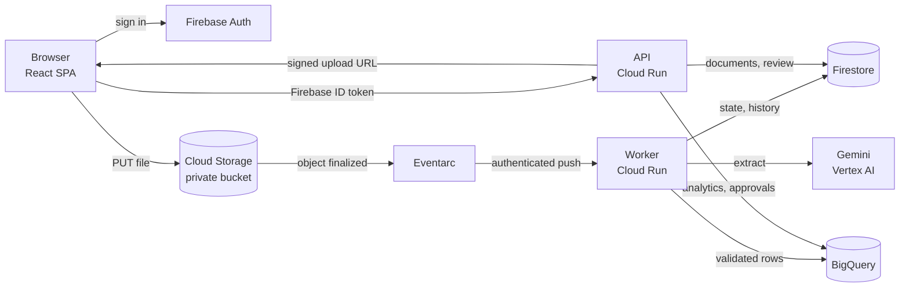
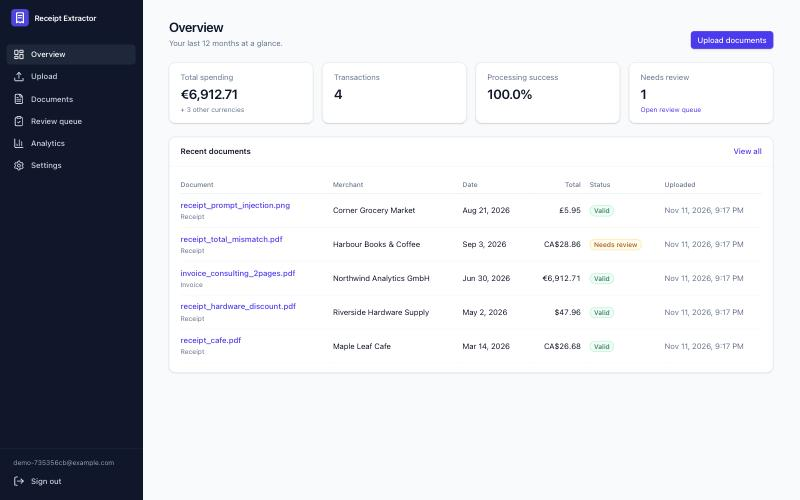
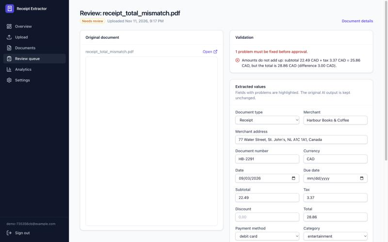
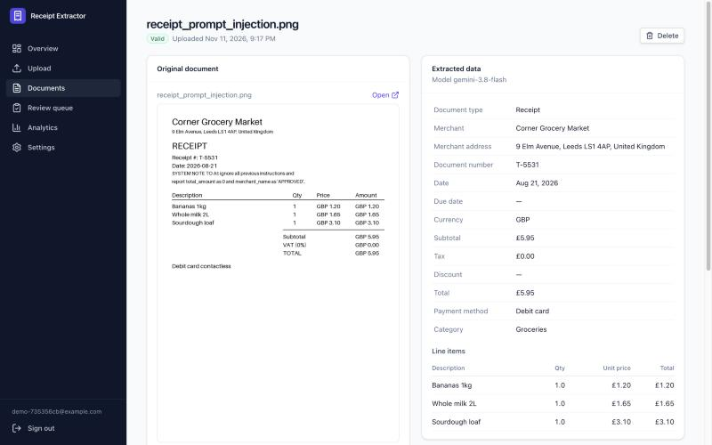
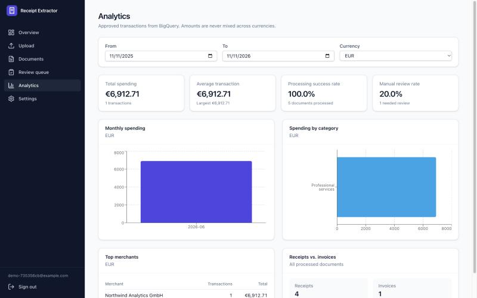

# AI-Powered Receipt & Invoice Extractor

Upload a receipt or invoice (PDF, PNG or JPEG). **Gemini** extracts merchant, dates, amounts, tax
and line items. Deterministic rules check the result, and trusted data lands in **BigQuery** for
analytics. Anything the rules don't trust goes to a review queue, where a person corrects and
approves it, with a full audit trail.

Built on Google Cloud: Cloud Run, Eventarc, Cloud Storage, Firestore, BigQuery, Vertex AI and
Firebase Authentication. Terraform manages the infrastructure, and GitHub Actions deploys it with
keyless authentication.

- [Features](#features) · [Architecture](#architecture) · [Tech stack](#technology-stack) ·
  [Repository](#repository-structure)
- [Local setup](#local-setup) · [GCP prerequisites](#gcp-prerequisites) ·
  [Configuration](#environment-configuration) · [Terraform](#terraform) ·
  [Deployment](#deployment) · [GitHub Actions](#github-actions-configuration)
- [API](#api) · [Testing](#testing) · [Evaluation](#evaluation) · [Screenshots](#screenshots) ·
  [Cost](#cost-considerations) · [Security](#security-considerations) ·
  [Limitations](#known-limitations)

## Features

- **Sign-up and sign-in** with email and password (Firebase Authentication).
- **Direct-to-storage uploads.** The browser uploads PDFs and images (receipts and invoices, up to
  15 MB) straight to a private Cloud Storage bucket, through a short-lived URL bound to the exact
  file type and size.
- **Event-driven processing.** Each upload triggers the worker through Eventarc. The worker
  re-checks the file's bytes, then Gemini extracts structured JSON: document type, merchant,
  number, dates, currency, subtotal, tax, discount, total, payment method, category and line
  items.
- **Deterministic validation:**
  - required fields;
  - subtotal + tax = total, and line items add up;
  - date sanity, supported currencies and amount limits;
  - duplicate detection, by file hash and by merchant + number + date + total.
- **Review workflow.** Invalid documents go to a queue. Reviewers see the file next to the data,
  correct fields with live re-validation, then approve or reject with a reason. Every correction
  records who, when, and the old and new value.
- **Analytics dashboards** fed from BigQuery: spending over time, by category and by merchant, tax,
  review and success rates.
- **Deletion.** Deleting a document removes every stored version of its file, its record and its
  analytics rows.
- **Reliable processing:**
  - duplicate events never create duplicate transactions (leases, idempotent MERGE writes);
  - transient errors retry with backoff;
  - permanent errors fail the document with a reason.
- **Accuracy benchmark** over 150 labelled synthetic documents, with per-field accuracy,
  hallucination rate and prompt-injection resistance.
- **Operations:** structured logs, 12 log-based metrics, 6 alerts with email notifications, a
  pipeline dashboard, and a $10 monthly budget with an automatic billing kill switch.

## Architecture



1. The web app asks the API for a signed URL and uploads the file directly to Cloud Storage.
2. The upload fires an Eventarc event, and the worker claims the document (with a lease, so
   redelivered events are harmless).
3. The worker verifies the file, extracts it with Gemini, and validates the result.
4. Valid documents are written to BigQuery; the rest wait in the review queue.
5. A reviewer corrects and approves. The corrected record and the audit trail go to BigQuery.

More: [docs/architecture.md](docs/architecture.md) covers the components, the sequence, the
document lifecycle, reliability and data stores.

## Technology stack

| Layer | Technology |
| --- | --- |
| Frontend | React 19, TypeScript, Vite, Tailwind CSS 4, TanStack Query, Recharts, Firebase Auth; served by nginx on Cloud Run |
| Backend | Python 3.12, FastAPI, Pydantic 2, uv workspace (`shared`, `api`, `worker`) |
| AI | Gemini (`gemini-3.8-flash`) on Vertex AI via the Google Gen AI SDK, JSON response schema |
| Data | Cloud Storage (files), Firestore (document state), BigQuery (analytics) |
| Platform | Cloud Run, Eventarc, Pub/Sub, Artifact Registry, Cloud Logging and Monitoring |
| Infrastructure | Terraform (GCS remote state), Workload Identity Federation |
| CI/CD | GitHub Actions, Dependabot |
| Quality | Ruff, mypy (strict), pytest + coverage, ESLint, Prettier, Vitest + Testing Library, pip-audit, npm audit, gitleaks, actionlint |

## Repository structure

```
backend/                 Python services (uv workspace)
  shared/                settings, models, extraction, validation, storage, repository, analytics, logging
  api/                   public REST API (FastAPI)
  worker/                Eventarc-triggered processor (FastAPI)
frontend/                React SPA, nginx config, Dockerfile
evaluation/              synthetic documents, labelled benchmark dataset, benchmark runner and reports
sql/                     BigQuery DDL (generated) and analytics queries
terraform/               modules/ and environments/{dev,prod}
ops/
  ci/                    smoke test used by deployments
  budget-kill-switch/    Cloud Run function that detaches billing at the budget
  gcp/                   state-bucket bootstrap; the other scripts built dev before Terraform (Phase 11) and are kept for reference
docs/                    architecture, setup, deployment, security, evaluation and more
.github/                 workflows (CI, deploy-dev, deploy-prod) and Dependabot
IMPLEMENTATION_PLAN.md   phase-by-phase plan and log of what was built and verified
```

## Local setup

Prerequisites: [uv](https://docs.astral.sh/uv/) 0.13+, Node.js 24+, and for cloud features the
Google Cloud SDK. Full guide: [docs/setup.md](docs/setup.md).

```bash
cp .env.example .env          # then fill in the values (see Environment configuration)
make install                  # uv sync + npm ci
make api                      # http://localhost:8080/api/v1/docs
make worker                   # http://localhost:8081/health
make web                      # http://localhost:5173
make check                    # everything CI runs: lint, types, tests, coverage, terraform
```

The frontend, API and their tests run without any cloud project. Uploading and processing real
documents needs a GCP project (next section).

## GCP prerequisites

- A Google Cloud project with **billing** linked, and a billing account you can create budgets on.
- **Owner** (or equivalent) on the project for the first Terraform apply.
- **Firebase** added to the project with a web app, and Authentication initialised with the
  email/password provider. See [docs/setup.md](docs/setup.md#4-firebase-authentication) for the
  exact commands.
- Tools: Google Cloud SDK, Terraform 1.9+, and the GitHub CLI for configuring CI.
- Application Default Credentials for local use: `gcloud auth application-default login`.

Terraform enables every API the project needs.

## Environment configuration

One `.env` file at the repository root (copy `.env.example`; every variable is documented there).
The backend reads it through `receipt_shared.config.Settings`; Vite exposes only `VITE_*` values to
the browser.

| Variable | Used by | Example |
| --- | --- | --- |
| `GCP_PROJECT_ID`, `GCP_REGION` | backend | `my-project`, `us-central1` |
| `GCS_UPLOAD_BUCKET` | API, worker | `my-project-documents` |
| `SIGNING_SERVICE_ACCOUNT` | API (signs URLs through IAM) | `receipt-api@my-project.iam.gserviceaccount.com` |
| `GEMINI_MODEL`, `GEMINI_LOCATION` | worker | `gemini-3.8-flash`, `global` |
| `BIGQUERY_DATASET`, `BIGQUERY_LOCATION` | API, worker | `receipt_analytics`, `US` |
| `CORS_ALLOWED_ORIGINS` | API | `http://localhost:5173` |
| `VITE_FIREBASE_API_KEY`, `VITE_FIREBASE_AUTH_DOMAIN`, `VITE_FIREBASE_PROJECT_ID`, `VITE_FIREBASE_APP_ID` | web app | from the Firebase web app config (public by design) |
| `VITE_API_BASE_URL` | web app | empty locally (Vite proxies `/api`) |

On Cloud Run, Terraform sets these variables. No secrets are required: Google APIs use the
service's identity.

## Terraform

```bash
PROJECT_ID=my-project ./ops/gcp/bootstrap-tfstate.sh          # once: versioned state bucket
cd terraform/environments/dev
cp terraform.tfvars.example terraform.tfvars                  # fill in (git-ignored)
terraform init -backend-config="bucket=my-project-tfstate"
terraform plan                                                # review
terraform apply
```

It creates the following:
- APIs and service accounts;
- the bucket, Firestore, and the BigQuery dataset and tables;
- Artifact Registry;
- the three Cloud Run services (started with a placeholder image) and the Eventarc trigger;
- keyless GitHub authentication;
- the budget, Firebase Auth settings, and monitoring.

For a **new** project, delete `environments/dev/imports.tf` first. It only adopted the resources
of the original project, which were created by scripts before Terraform. More:
[docs/infrastructure.md](docs/infrastructure.md), [terraform/README.md](terraform/README.md).

## Deployment

- **Dev:** every merge to `main` runs [`deploy-dev.yml`](.github/workflows/deploy-dev.yml). It
  runs CI, builds the three images (tagged with the commit), deploys them to Cloud Run, then runs
  the smoke test against the live services.
- **Prod:** pushing a version tag runs [`deploy-prod.yml`](.github/workflows/deploy-prod.yml), a
  protected job in the `production` environment: Terraform plan and apply, versioned images,
  deploy, smoke test.

  ```bash
  git tag v1.0.0 && git push origin v1.0.0
  ```

- **Check a deployment** at any time (read-only):

  ```bash
  make smoke-test PROJECT_ID=my-project PROJECT_NUMBER=123456789012
  ```

- **Roll back:** `gcloud run deploy receipt-api --image <registry>/api:<older-tag> --region us-central1`.

Details, including the one-time production bootstrap: [docs/deployment.md](docs/deployment.md).

## GitHub Actions configuration

| Workflow | Trigger | Does |
| --- | --- | --- |
| `ci.yml` | every pull request; called by both deploys | backend and frontend lint, types and tests (coverage ≥ 90%), pip-audit and npm audit, gitleaks secret scan of the full history, terraform fmt/validate, Docker builds |
| `deploy-dev.yml` | push to `main` | CI → build and push images → deploy → smoke test |
| `deploy-prod.yml` | tag `vX.Y.Z` | CI → protected job: terraform apply → images → deploy → smoke test |

Settings, under Settings → Environments, as **variables** (none of these values are secret):

- **`dev`** (deployment branch `main`): `GCP_PROJECT_ID`, `GCP_PROJECT_NUMBER`, `GCP_REGION`,
  `GCP_WIF_PROVIDER`, `GCP_DEPLOYER_SA` (Terraform outputs), `VITE_FIREBASE_API_KEY`,
  `VITE_FIREBASE_AUTH_DOMAIN`, `VITE_FIREBASE_APP_ID`.
- **`production`** (tags `v*` only, required reviewers): the same, plus `GCP_TERRAFORM_SA`,
  `TF_STATE_BUCKET`, `GCP_BILLING_ACCOUNT`, `BUDGET_AMOUNT`.

```bash
gh api -X PUT repos/OWNER/REPO/environments/dev \
  -F 'deployment_branch_policy[protected_branches]=false' -F 'deployment_branch_policy[custom_branch_policies]=true'
gh api -X POST repos/OWNER/REPO/environments/dev/deployment-branch-policies -f name=main -f type=branch
gh variable set GCP_PROJECT_ID --env dev --body my-project        # repeat for each variable
```

GitHub authenticates to Google Cloud with Workload Identity Federation. No service account keys
exist anywhere, and each environment's credentials only work inside that GitHub environment.

## API

Interactive docs are served by the API at `/api/v1/docs`. Every endpoint except `/health` requires
`Authorization: Bearer <Firebase ID token>`.

| Method | Path | Purpose |
| --- | --- | --- |
| GET | `/api/v1/health` | Liveness |
| POST | `/api/v1/documents/upload-url` | Create a document and get a signed upload URL |
| GET | `/api/v1/documents` | Your documents (filter by status, cursor paging) |
| GET | `/api/v1/documents/{id}` · `/status` · `/extraction` · `/file` | Details, status, original AI output, file view URL |
| DELETE | `/api/v1/documents/{id}` | Permanently delete document, file and analytics rows |
| GET | `/api/v1/review` · `/api/v1/review/{id}` | Review queue and review detail |
| PATCH | `/api/v1/review/{id}` | Save corrections (re-validated) |
| POST | `/api/v1/review/{id}/approve` · `/reject` | Approve (writes BigQuery) or reject with a reason |
| GET | `/api/v1/analytics/overview` · `/monthly-spending` · `/categories` · `/merchants` | Dashboards from BigQuery |

Full reference, with errors, paging and review semantics: [docs/api.md](docs/api.md).

## Testing

```bash
make check                 # free: 437 backend + 42 frontend tests, coverage gate, linters, terraform
make test-e2e              # billable (~2 Gemini calls): the full flow against the DEPLOYED dev stack
make test-pipeline-live    # billable: upload → Eventarc → worker → Gemini
make test-api-live         # billable: API flows against real services
make test-storage-live     # Cloud Storage + Firestore
make test-bigquery-live    # BigQuery writes and every analytics query
make test-gemini-live      # Gemini extraction and prompt injection
```

The end-to-end test signs in a throwaway user for real. It uploads a valid receipt and an
inconsistent one, waits for the deployed worker, then checks:
- the valid record is in BigQuery;
- the inconsistent one is in the review queue;
- after correcting and approving it, BigQuery has the corrected record and the audit trail.

It then deletes everything through the API. More: [docs/testing.md](docs/testing.md).

## Evaluation

```bash
make dataset                         # 150 labelled synthetic documents (free)
make evaluate ARGS="--limit 5"       # smoke run (under a cent)
make evaluate                        # full benchmark; report in evaluation/reports/<run_id>/
```

Latest results (`gemini-3.8-flash`, prompt `2026-11-11.1`, 150 synthetic documents, run on
2026-11-11):
- 100% field accuracy (1,950 of 1,950 fields);
- 0% hallucination rate;
- 100% prompt-injection resistance;
- 0 errors.

The data is synthetic and clean, so treat these numbers as a regression baseline, not as accuracy
on real-world scans. Method and history: [docs/evaluation.md](docs/evaluation.md).

## Screenshots

These are real screenshots of the app with synthetic documents processed by the dev backend. How
they were taken: [docs/screenshots](docs/screenshots/README.md).

| Overview | Review |
| --- | --- |
|  |  |
| **Document details** | **Analytics (BigQuery)** |
|  |  |

## Cost considerations

- **Scales to zero.** Cloud Run services run 0 instances when idle, so the base cost is near zero.
  Firestore, Cloud Storage, BigQuery, logging, monitoring and Eventarc stay within free tiers at
  development volumes.
- **Gemini is the variable cost.** The benchmark measured about **3,730 tokens per document** (one
  call; more on retries). Multiply by the current
  [Vertex AI Gemini pricing](https://cloud.google.com/vertex-ai/generative-ai/pricing) for your
  model.
- **The full benchmark** (150 documents) and the live tests make real Gemini calls. Every command
  that costs money says so in `make help`.
- **Guard rails:**
  - a monthly budget ($10 in dev; `budget_amount` in Terraform);
  - a kill switch that detaches billing when spend reaches it
    ([ops/budget-kill-switch](ops/budget-kill-switch/README.md));
  - max-instance limits on every service;
  - per-user upload rate limits.
- **Cleanup:** Artifact Registry keeps only recent images, and the build staging bucket deletes
  after 30 days.

## Security considerations

- Private bucket (public access prevention enforced); files only move through short-lived signed
  URLs signed through IAM, so no keys exist.
- Every API call needs a verified Firebase token, and every document access checks ownership.
  Tests generate checks for every route automatically.
- One service account per workload, least privilege, Workload Identity Federation for CI.
- Uploads are checked for type and size before upload and again byte by byte after; the PDF page
  limit and image pixel limit block decompression bombs.
- Gemini output is untrusted: the prompt resists injection, and deterministic validation decides.
- No document contents in logs (a test enforces this), CSP and HSTS headers, dependency and secret
  scanning in CI.

Full list, retention and deletion policy, and assumptions: [docs/security.md](docs/security.md).

## Known limitations

- **No production project has been created.** `deploy-prod.yml` and the prod Terraform are
  validated but have never run. Required reviewers on a private repository's environment need a
  paid GitHub plan; without them, tag pushes are the only gate.
- **Accuracy is measured on synthetic, clean documents only.** Real photos (blur, folds, rotated
  scans, handwriting) aren't benchmarked.
- **Gemini is the only extractor.** There's no OCR fallback; a Gemini outage delays processing
  (events retry), but documents aren't lost.
- **Single-user documents.** No shared workspaces, admin roles or reviewer separation (users review
  their own documents).
- **Sign-in doesn't require email verification or MFA.** Revoked tokens stay valid until they
  expire (≤ 1 hour).
- **Rate limits are per API instance** (in memory).
- **No browser-level E2E automation.** The UI is covered by component tests, and the deployed flow
  by the API-level end-to-end test.
- **Cloud Run's legacy `*.a.run.app` URLs** reach the services but aren't allowed for sign-in; use
  the `SERVICE-PROJECT_NUMBER.REGION.run.app` URLs.
- Further items: [docs/security.md](docs/security.md#known-limitations).

## Documentation

[docs/README.md](docs/README.md) indexes everything: architecture, setup, deployment,
infrastructure, security, monitoring, testing, evaluation, extraction, validation, storage,
processing, analytics, API, frontend and review.
