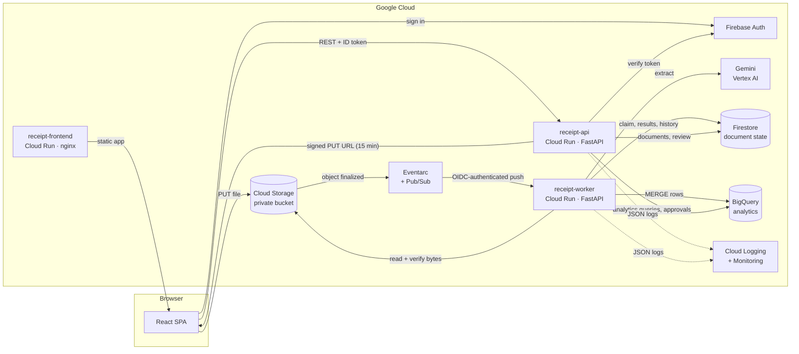
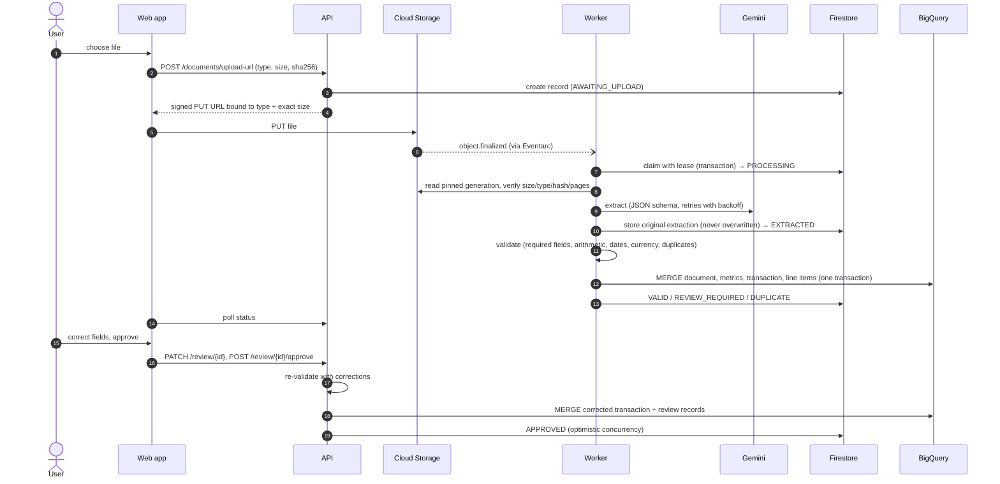
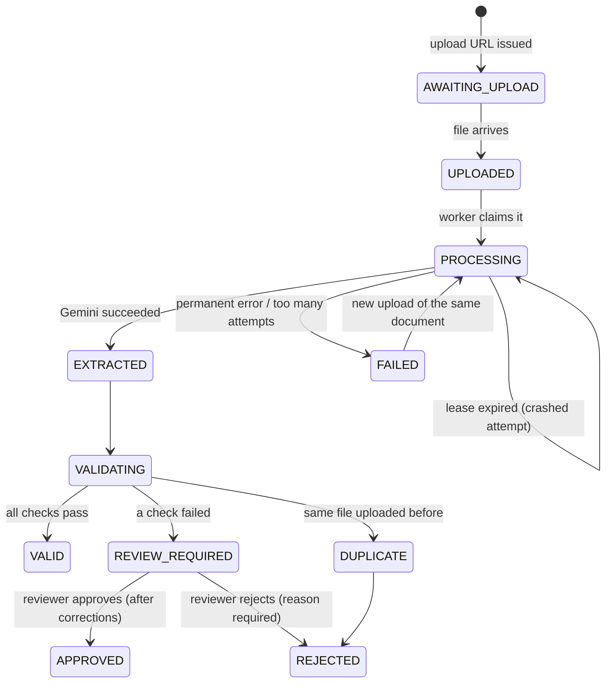
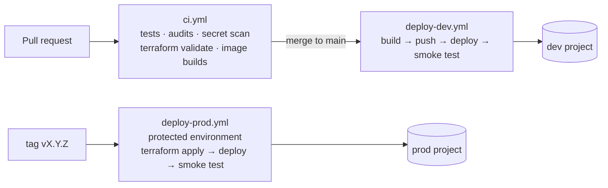

# Architecture

An event-driven pipeline on Google Cloud. Users upload receipts and invoices. Gemini extracts
structured data, deterministic rules decide whether to trust it, trusted data lands in BigQuery,
and everything else waits for a person to review it.

## Components

| Component | Responsibility | Does **not** |
| --- | --- | --- |
| **Frontend** (`frontend/`) | Sign-in, upload (straight to Cloud Storage), document list and details, review editor, analytics dashboards | Hold any credential except the user's Firebase ID token |
| **API** (`backend/api`) | Verify tokens, enforce ownership, issue signed URLs, serve documents, apply corrections and approvals, run analytics queries, delete documents | Call Gemini or process files |
| **Worker** (`backend/worker`) | Receive storage events, verify the uploaded bytes, call Gemini, validate, persist results, write analytics rows | Accept requests from the internet (internal ingress, Eventarc only) |
| **Shared** (`backend/shared`) | Settings, models, extraction engine, validation engine, storage, repository, BigQuery writer, logging | Run as a service |

## Processing an upload

## Document lifecycle

Only `VALID` and `APPROVED` documents produce rows in `extracted_transactions` and `line_items`.
Every document gets a row in `documents` and `extraction_metrics`, so dashboards show the review
and failure rates too.

## Reliability

- **At-least-once events, exactly-once effects.** Eventarc may deliver an event more than once. The
  worker claims a document in a Firestore transaction with a lease (360 s), keyed by the object's
  generation:
  - a redelivery while the lease is live gets HTTP 429, so Eventarc retries later;
  - a redelivery after completion is acknowledged without doing any work;
  - a crashed attempt is retaken once its lease expires.
- **Idempotent analytics.** Each BigQuery write is one multi-statement transaction that MERGEs on
  keys and replaces line items. Re-running it leaves exactly one row per key. DML is used instead
  of streaming inserts, so rows can be corrected and deleted immediately.
- **Retries with limits.** Gemini calls retry transient errors with exponential backoff (4
  retries, 120 s timeout). The worker gives up after 5 processing attempts and marks the document
  `FAILED` with a reason. Eventarc's subscription backs off between redeliveries (10–600 s).
- **The original AI output is immutable.** Corrections are stored separately with who, when,
  previous and new value, and every save re-runs validation.
- **Optimistic concurrency.** Review writes are conditional on `updated_at`, so two tabs or a late
  worker write can't overwrite each other silently (409).

## Data

| Store | Holds | Why this store |
| --- | --- | --- |
| Cloud Storage `<project>-documents` | Original files at `uploads/{user}/{document}/{name}` | Cheap, private, signed-URL uploads, object-finalized events |
| Firestore `documents/{id}` | Status, history, original extraction, validation, corrections, duplicate fingerprint | Transactions for claims and reviews, per-user queries with composite indexes |
| BigQuery `receipt_analytics` | `documents`, `extracted_transactions`, `line_items`, `review_records`, `extraction_metrics` | SQL analytics over exact `NUMERIC` money, partitioned by date, clustered by user |

Schema details: [analytics.md](analytics.md). The Terraform table definitions are generated from the
same Python specs as the SQL files, and a test fails if they drift.

## AI extraction

- Gemini (`gemini-3.8-flash`, Vertex AI `global` endpoint) with a JSON response schema and a
  versioned prompt (`PROMPT_VERSION`). PDFs and images are sent inline.
- The prompt treats the document as untrusted data (prompt-injection resistant). The output is
  parsed into Pydantic models with `Decimal` money.
- Validation is deterministic and independent of the model:
  - required fields;
  - subtotal + tax = total, and line items add up (±0.02);
  - dates and currencies;
  - amount limits;
  - duplicates (same file hash, or same merchant + number + date + total).

Details: [extraction.md](extraction.md), [validation.md](validation.md). Measured accuracy:
[evaluation.md](evaluation.md).

## Security boundaries

- Only the frontend and the API are public. The worker accepts only Eventarc's OIDC-authenticated
  calls (internal ingress plus the invoker role).
- The browser holds a Firebase ID token. The API derives the user only from a verified token, and
  every document access checks ownership.
- Files never pass through the API: uploads and previews use short-lived signed URLs, signed
  through IAM, so no keys exist.
- One service account per workload, with permissions granted on individual resources.

Full list: [security.md](security.md).

## Environments and delivery

- **Terraform** owns all infrastructure and service settings (`terraform/`). **CI** owns which
  container image is running.
- **GitHub Actions** authenticates with Workload Identity Federation. Each environment's
  credentials only work in that GitHub environment.

Details: [infrastructure.md](infrastructure.md), [deployment.md](deployment.md).

## Observability

- **Logs:** structured JSON with `document_id`, statuses and timings, never contents.
- **Metrics:** 12 log-based metrics.
- **Alerts:** 6 alert policies with email notifications.
- **Dashboard:** one pipeline dashboard.

Details: [monitoring.md](monitoring.md).

## Cost controls

- Everything scales to zero (Cloud Run min instances = 0).
- A monthly budget publishes to Pub/Sub. A kill-switch function detaches billing when spend
  reaches the budget ([ops/budget-kill-switch](../ops/budget-kill-switch/README.md)).
- Gemini is the main variable cost; see the README's cost section.
