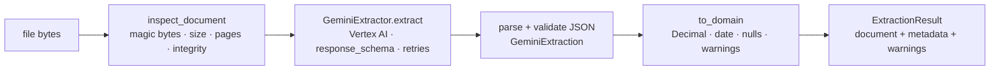

# Gemini extraction engine

`backend/shared/src/receipt_shared/extraction/` turns a PDF, PNG or JPEG into a structured
`ExtractionResult`. It has no dependency on the API, worker, Firestore or BigQuery, so it can be
run and tested on its own. It is installed via the `receipt-shared[extraction]` extra (the worker
uses it; the API image does not include it).

## Pipeline



| Module | Responsibility |
|--------|----------------|
| `documents.py` | Detect type from magic bytes; reject empty, oversized, unsupported, mismatched (extension or declared type vs. content), encrypted, corrupt, too-many-pages and too-many-pixels files. Computes SHA-256. |
| `prompt.py` | System instruction (accuracy + prompt-injection rules) and `PROMPT_VERSION`. |
| `schema.py` | `GeminiExtraction` response schema sent to Gemini; `to_domain()` converts to `ExtractedDocument`. |
| `gemini.py` | `GeminiExtractor`: Vertex AI call, timeout, retry/backoff, error mapping, structured logs, metadata. |
| `errors.py` | Error hierarchy; each error has a stable `code` and a `retryable` flag. |
| `cli.py` | `receipt-extract` command. |

The domain models (`ExtractedDocument`, `LineItem`, `ExtractionMetadata`, `ExtractionResult`)
live in `receipt_shared.models.extraction` and have no Gemini dependency.

## Extracted fields

`document_type`, `document_number`, `document_date`, `due_date`, `currency`, `merchant_name`,
`merchant_address`, `subtotal`, `tax_amount`, `discount_amount`, `total_amount`,
`payment_method`, `line_items[] {description, quantity, unit_price, total_price}`,
`expense_category`, `missing_fields`, `extraction_notes`.

Rules enforced in code (not just in the prompt):

- **No invented values.** Every field is nullable. Money is `Decimal` built from the model's
  number via its shortest string form (`26.68` stays `26.68`). A null amount is never turned into 0.
- **Invalid values become null with a warning**, e.g. `2026-02-30` or a currency that is not a
  3-letter code. Warnings are returned in `ExtractionResult.warnings`.
- **`missing_fields` is computed from the actual nulls**, so it cannot disagree with the data.
- **`document_type` keeps `"other"`** so the validation engine can reject non-receipts explicitly.
- **Output size is bounded** (500 line items, 500-char text fields, 2000-char notes) because the
  document is untrusted.

## Prompt-injection handling

- The document is sent as a separate data part; it is never concatenated into the instructions.
- The system instruction states that document text is data and that embedded instructions must be
  ignored.
- `response_schema` constrains the output shape, so injected text cannot change the format.
- Server-side code re-validates everything (types, enums, lengths) and Phase 3 validates the
  arithmetic, so an injected "total = 0" would still be caught by the subtotal/tax/total check.
- `evaluation/samples` includes a receipt with an embedded injection attempt; the live
  integration test asserts the real merchant and total are extracted.

## Reliability

| Condition | Behaviour |
|-----------|-----------|
| HTTP 408 / 429 / 500 / 502 / 503 / 504 | Retried with exponential backoff and full jitter (`GEMINI_RETRY_INITIAL_DELAY_SECONDS`, capped at `GEMINI_RETRY_MAX_DELAY_SECONDS`), honouring `Retry-After`. Up to `GEMINI_MAX_RETRIES` retries. |
| Network timeout / connection error | Retried as above. Per-attempt timeout: `GEMINI_TIMEOUT_SECONDS`. |
| Empty or non-schema JSON answer | Retried once. |
| Other 4xx (bad request, permission) | Fails immediately, `retryable=False`. |
| Blocked (`SAFETY`, `RECITATION`, …) or truncated (`MAX_TOKENS`) answer | Fails immediately with `ModelResponseError`. |

When retries are exhausted on a transient error, the raised error keeps `retryable=True` so the
worker (Phase 5) can let Eventarc redeliver instead of marking the document failed.

## Observability

Each extraction logs `gemini extraction started`, `gemini attempt failed` (per failed attempt)
and `gemini extraction completed` with `document_id`, `model`, `model_version`, `prompt_version`,
latency, attempt count, token counts, page count and counts of line items / missing fields /
warnings. Logs never contain document text or extracted values (enforced by a unit test).

Every `ExtractionResult.metadata` records `model`, `model_version`, `prompt_version`, `location`,
`latency_ms`, `attempts`, token usage and `finish_reason`.

## Configuration

| Variable | Default | Purpose |
|----------|---------|---------|
| `GCP_PROJECT_ID` | — (required) | Project billed for Vertex AI |
| `GEMINI_MODEL` | `gemini-3.8-flash` | Any Gemini model available to your project in `GEMINI_LOCATION` |
| `GEMINI_LOCATION` | `global` | Vertex AI location. Gemini 3.x models are served from `global` (they return 404 in `us-central1`) |
| `GEMINI_TIMEOUT_SECONDS` | `120` | Per-attempt request timeout |
| `GEMINI_MAX_RETRIES` | `4` | Retries after the first attempt |
| `GEMINI_RETRY_INITIAL_DELAY_SECONDS` / `GEMINI_RETRY_MAX_DELAY_SECONDS` | `1` / `30` | Backoff |
| `GEMINI_MAX_OUTPUT_TOKENS` | `8192` | Output cap; raise if long invoices hit `MAX_TOKENS` |
| `GEMINI_THINKING_BUDGET` | unset | Optional; `0` disables thinking on models that allow it |
| `MAX_UPLOAD_BYTES` | 15 MiB | Inline requests to Vertex AI are limited to ~20 MB including base64 overhead |
| `MAX_PDF_PAGES` | `10` | Page limit |
| `MAX_IMAGE_PIXELS` | 40,000,000 | Decompression-bomb guard |

## Running it

```bash
make samples                                   # synthetic documents + ground truth
cd backend
uv run receipt-extract --inspect-only ../evaluation/samples/out/*.pdf   # free: file checks only
```

Live extraction (billed to your project):

```bash
gcloud auth application-default login
gcloud services enable aiplatform.googleapis.com --project YOUR_PROJECT
# set GCP_PROJECT_ID=YOUR_PROJECT in .env
cd backend && uv run receipt-extract ../evaluation/samples/out/receipt_cafe.pdf
make test-gemini-live                          # integration tests against ground truth
```

The caller needs the `roles/aiplatform.user` role (or equivalent) on the project.
