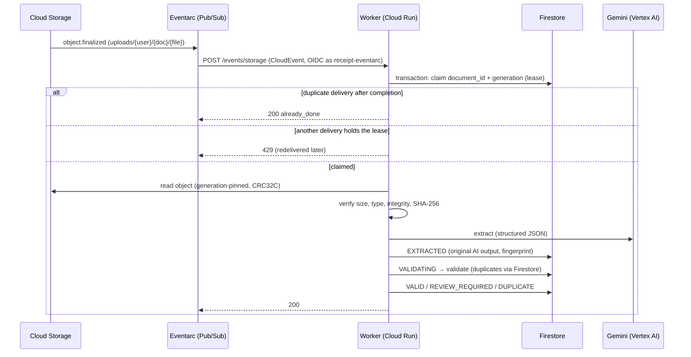

# Event-driven processing (worker)



## Statuses

`AWAITING_UPLOAD → UPLOADED → PROCESSING → EXTRACTED → VALIDATING → VALID | REVIEW_REQUIRED | DUPLICATE | FAILED`,
then `REVIEW_REQUIRED → APPROVED | REJECTED` (Phase 9). Each transition is appended to the
record's `history` with a timestamp.

## Idempotency and retries

Eventarc delivers at least once, so `DocumentProcessor.handle` is safe to run repeatedly:

| Situation | Behaviour | HTTP |
|-----------|-----------|------|
| Event for a document already processed (same generation) | Acknowledged, no work | 200 `already_done` |
| Event while another delivery holds the lease | Pub/Sub redelivers later | 429 `in_progress` |
| Previous attempt crashed (lease expired, `WORKER_LEASE_SECONDS`) | Re-claimed, attempt count +1 | — |
| Crash after Gemini answered | Stored extraction reused: no second Gemini call, original output untouched | — |
| Transient error (Gemini 429/5xx/timeout, unexpected exception) | Lease released, `last_error` recorded, redelivered with backoff | 503 / 500 |
| More than `MAX_PROCESSING_ATTEMPTS` attempts | FAILED (`too_many_attempts`) | 200 `gave_up` |
| Permanent error (corrupt/spoofed file, wrong size or checksum, Gemini refusal, 4xx) | FAILED; validation `PROCESSING_FAILED` | 200 |
| Object not under `uploads/`, other bucket, other event type | Ignored | 200 |
| No record for the document (not uploaded via the API) or object mismatch | Ignored and logged as a warning | 200 |
| A second upload (new generation) to an already-processed document | Ignored (`stale_generation`) | 200 |
| Malformed CloudEvent | Logged at ERROR, acknowledged so it isn't redelivered forever | 200 |

The claim is a Firestore transaction keyed by `document_id` + object `generation`. The file
hash is stored before Gemini runs, so concurrent uploads of the same file can detect each other.

## Stored per document

`object_generation`, `file_sha256`, `page_count`, `processing_attempts`, `uploaded_at`,
`processing_started_at`, `extracted_at`, `completed_at`, `processing_duration_ms`,
`model_version`, `last_error`, `extraction` (original Gemini output, written once), `validation`,
duplicate fingerprint fields, and `history`.

## Deployment

| Resource | Setting |
|----------|---------|
| Cloud Run `receipt-worker` | `--no-allow-unauthenticated`, `--ingress internal`, 1 vCPU, 1 GiB, concurrency 4, timeout 300 s, 0–3 instances |
| Eventarc trigger `receipt-upload-finalized` | `google.cloud.storage.object.v1.finalized` on the documents bucket → `/events/storage` |
| Pub/Sub subscription (Eventarc-managed) | ack deadline 600 s, retry backoff 10–600 s |
| `receipt-worker` SA | `storage.objectViewer` on the bucket, `datastore.user`, `aiplatform.user` |
| `receipt-eventarc` SA | `eventarc.eventReceiver`, `run.invoker` on the worker only |
| `receipt-build` SA | `artifactregistry.writer` on the repository, `logging.logWriter` |
| Artifact Registry `receipt-extractor` | Docker, us-central1; keeps 10 recent images, deletes untagged images after 7 days |

```bash
PROJECT_ID=my-project ./ops/gcp/bootstrap-worker.sh   # once, idempotent
PROJECT_ID=my-project ./ops/gcp/deploy-worker.sh      # build + deploy (billable)
make test-pipeline-live                                             # end-to-end (billable)
```

BigQuery loading of VALID documents is added in Phase 6 (the `ValidSink` hook in the pipeline).
