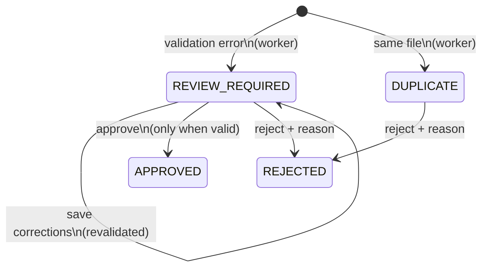

# Manual review (human in the loop)

## Workflow (spec → implementation)

| Requirement | How |
|-------------|-----|
| Save the extraction result | Worker stores `extraction` (original Gemini output) once; never modified afterwards |
| Save the validation errors | `validation` on the document: codes, plain-English messages, `failed_fields` |
| Status REVIEW_REQUIRED and review queue | Worker sets it; `GET /review` / *Review queue* page |
| Open the document | `GET /review/{id}` / *Review editor*: original file beside the fields |
| Correct fields | `PATCH /review/{id}` with only the changed fields; stored in `review.corrected` |
| Revalidate | Every save, and every time the review is opened (current rules, e.g. a newly supported currency) |
| Approve only when valid | `can_approve`; the server re-validates and refuses with 409 plus the remaining errors |
| Save to BigQuery | One atomic transaction: approved transaction (`record_source = REVIEWED`), line items, document row, `review_records` |
| Who approved and when | `approved_by` / `approved_at` on the document, the BigQuery transaction and the APPROVE audit row; shown on the document page |
| Reject with a reason | `POST /review/{id}/reject` (3–500 chars); `rejection_reason`, REJECT audit row; removed from approved analytics |

## Audit trail

Every changed field appends an entry: **field, original AI value, previous value, corrected value,
reviewer, timestamp**. It's stored on the document immediately (`review.corrections`) and exported
to BigQuery `review_records` with the decision (MERGE on `review_id`, so it's idempotent). The
original AI output is never overwritten. The document page shows the decision and the full
correction history.

## Concurrency

Review writes use optimistic concurrency (`update_if_unchanged`: a Firestore transaction comparing
`updated_at`). If the document changed after it was opened (another tab, a double click, an
approve racing a reject), the action fails with **409 "Reload to see the latest version"**, and
the editor reloads automatically. Decisions write BigQuery first. If the Firestore commit then
loses a race, BigQuery is rewritten to match the winning decision, so the two stores agree.

The editor warns before you close the tab with unsaved corrections.
