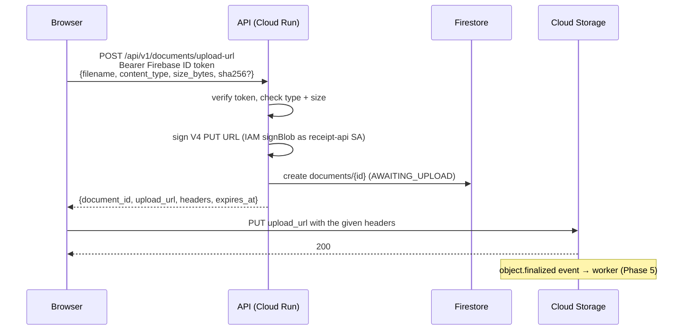

# Document uploads and storage

Files never pass through the API. The API authenticates the user, validates the request, creates
a document record and returns a short-lived signed URL; the browser uploads straight to Cloud
Storage.



## `POST /api/v1/documents/upload-url`

Request:

```json
{"filename": "receipt.pdf", "content_type": "application/pdf", "size_bytes": 53370,
 "sha256": "optional 64-hex digest"}
```

Response `201`:

```json
{"document_id": "8f0c…", "upload_url": "https://storage.googleapis.com/…",
 "method": "PUT",
 "headers": {"Content-Type": "application/pdf", "x-goog-content-length-range": "53370,53370"},
 "expires_at": "2026-11-09T21:40:00Z", "status": "AWAITING_UPLOAD"}
```

The upload must send exactly the returned headers.

| Status | `error.code` | When |
|--------|--------------|------|
| 401 | `unauthorized` | Missing, invalid or expired Firebase ID token |
| 413 | `file_too_large` | `size_bytes` > `MAX_UPLOAD_BYTES` |
| 415 | `unsupported_file_type` | Not PDF/PNG/JPEG, or the extension doesn't match the content type |
| 422 | `validation_error` | Malformed body (e.g. non-positive size, bad sha256) |
| 503 | `service_unavailable` | Bucket not configured |

The user id comes **only** from the verified token. A `user_id` sent in the body is ignored.

## Object layout (bucket `PROJECT-documents`)

| Prefix | Contents |
|--------|----------|
| `uploads/{user_id}/{document_id}/{filename}` | Original documents (signed-URL uploads only) |
| `processed/{user_id}/{document_id}/…` | Worker outputs (Phase 5) |
| `evaluation/…` | Benchmark documents (Phase 10) |
| `tmp/…` | Scratch, deleted after 1 day |

Filenames are sanitised: path components, non-ASCII characters and unsafe characters are removed,
and the name is capped at 120 characters with the extension kept. User and document ids must match
`[A-Za-z0-9_-]{1,128}`.

## Security controls

| Control | How |
|---------|-----|
| No public access | Public access prevention **enforced**; uniform bucket-level access (no object ACLs) |
| Least privilege | `receipt-api` SA: `storage.objectCreator` + `storage.objectViewer` on **this bucket only**; `datastore.user`; Token Creator on itself (to sign) |
| No keys | URLs are signed through IAM `signBlob`; there are no service-account key files |
| Short-lived URLs | `SIGNED_URL_TTL_SECONDS` (default 15 min) |
| Type and size bound to the URL | Content-Type and `x-goog-content-length-range: N,N` are part of the signature. A different type → 403, a different size → 400 |
| Path bound to the URL | The signature covers the object name, so the URL can't write elsewhere (403) |
| Integrity after upload | `storage.verify.verify_upload`: exact size, magic bytes vs. declared type, PDF/image integrity, page and pixel limits, optional client SHA-256 (constant-time compare). Downloads are CRC32C-checked |
| Encryption | Google-managed encryption at rest (default); TLS in transit |
| Versioning and retention | Object versioning on; noncurrent versions deleted after 30 days; incomplete multipart uploads aborted after 1 day; soft delete (7-day default) |
| Browser access | CORS allows `PUT`/`GET`/`HEAD` only from configured origins (`http://localhost:5173` for development) |
| Authentication | Firebase ID tokens verified with firebase-admin (signature, expiry, audience = project, issuer). Revocation isn't checked per request, to avoid an extra network call |

## Provisioning

`ops/gcp/bootstrap-storage.sh` (idempotent) enables the APIs and creates the bucket (with
versioning, lifecycle, CORS and labels), the Firestore `(default)` database (Native,
`us-central1`) and the `receipt-api` service account with the bindings above. Phase 11 moves this
into Terraform.

```bash
PROJECT_ID=receipt-extractor-lkmljr DEVELOPER_EMAIL=you@example.com ./ops/gcp/bootstrap-storage.sh
```

`DEVELOPER_EMAIL` grants your user Token Creator on the API service account, so the API can sign
URLs when run locally. Then set in `.env`:

```
GCS_UPLOAD_BUCKET=receipt-extractor-lkmljr-documents
SIGNING_SERVICE_ACCOUNT=receipt-api@receipt-extractor-lkmljr.iam.gserviceaccount.com
```

## Tests

- Unit tests: paths and filename sanitisation, signing arguments, integrity checks, the repository,
  and the endpoint (auth, types, sizes, ignored `user_id`).
- Live (`make test-storage-live`, opt-in): issues a URL through the real endpoint, uploads the
  sample PDF to the real bucket, checks the Firestore record, reads the object back and verifies
  it, checks the signed download and that anonymous access is denied, and checks that a wrong
  content type, wrong size or different path is rejected. Everything it creates is deleted
  afterwards. Sign-in is the only part replaced (a fixed test user).
