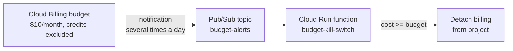

# Budget kill switch

Stops all paid usage in the project when monthly spend reaches the budget, by detaching the
billing account from the project. Google Cloud budgets only send alerts; this function turns the
alert into a hard stop.



## Behaviour

- Budget notifications arrive several times a day with the month's cost so far.
- If `costAmount >= budgetAmount * KILL_RATIO`, the function detaches billing. Every paid service
  in the project stops, including Gemini, Cloud Run, Firestore and BigQuery.
- **Not instant.** Billing data lags by hours, so final spend can exceed the budget somewhat.
- **Credits are excluded** from the budget, so it measures real usage even while free-trial
  credits pay for it.
- To recover, re-link the billing account:
  Console → Billing → *My projects* → `receipt-extractor-lkmljr` → *Change billing*. Google warns
  that projects left without billing for a long time may have resources deleted.

| Env var | Value | Meaning |
|---------|-------|---------|
| `TARGET_PROJECT_ID` | `receipt-extractor-lkmljr` | Project whose billing is detached |
| `DRY_RUN` | `false` | `true` only logs "would disable billing" |
| `KILL_RATIO` | `1.0` | Fraction of the budget that triggers the stop |

## Permissions (least privilege)

Service account `budget-kill-switch@<project>.iam.gserviceaccount.com` has:

- `roles/billing.projectManager` on the project: create/delete the billing assignment only.
- Custom role `killSwitchProjectReader` (`resourcemanager.projects.get` only), needed to read
  whether billing is enabled.
- `roles/run.invoker` on this one Cloud Run service, so the Eventarc trigger can call it.

`billing-budget-alert@system.gserviceaccount.com` has `roles/pubsub.publisher` on the topic.
The function only accepts internal traffic (`--ingress-settings internal-only`) and requires
authentication.

## Deploy / update

```bash
P=receipt-extractor-lkmljr
cd ops/budget-kill-switch
gcloud functions deploy budget-kill-switch --gen2 --project $P --region us-central1 \
  --runtime python312 --source . --entry-point on_budget_notification \
  --trigger-topic budget-alerts \
  --service-account budget-kill-switch@$P.iam.gserviceaccount.com \
  --set-env-vars TARGET_PROJECT_ID=$P,DRY_RUN=false,KILL_RATIO=1.0 \
  --no-allow-unauthenticated --ingress-settings internal-only \
  --memory 256Mi --max-instances 1
```

Phase 11 moves this into Terraform.

## Testing

Unit tests (no cloud calls):

```bash
cd backend && uv run pytest ../ops/budget-kill-switch/test_kill_switch.py
```

Safe end-to-end check. Use an amount **below** the budget unless the function is in dry-run
mode, otherwise billing is really detached:

```bash
gcloud pubsub topics publish budget-alerts --project receipt-extractor-lkmljr \
  --message='{"costAmount":3.0,"budgetAmount":10.0,"currencyCode":"USD"}'
gcloud logging read 'resource.labels.service_name="budget-kill-switch"' \
  --project receipt-extractor-lkmljr --freshness=10m --limit 5
```

Verified on 2026-11-09:
- In dry-run mode, a $12 test notification logged
  `DRY RUN: budget reached; would disable billing` and billing stayed enabled.
- After arming, a $3 notification logged `under budget; no action`.
- The real "disable" path has **not** been exercised against live billing (it is covered by
  unit tests).
